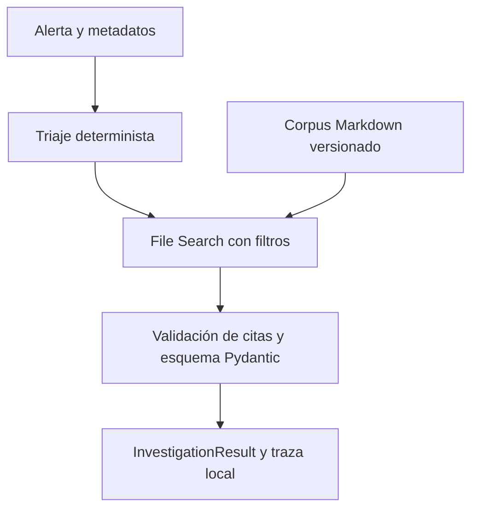

# Data Quality Triage Agent

Proyecto de prácticas de ingeniería de agentes. La práctica 1 clasifica alertas con reglas explícitas y cuatro herramientas deterministas de solo lectura. La práctica 2 añade investigación recuperada de documentación sintética y citas verificables. No requiere un almacén de datos productivo.

## Arquitectura



El triaje determina la severidad y el requisito de aprobación. File Search recupera evidencia del corpus autorizado. El validador confirma que las citas pertenecen a resultados recuperados; si falta evidencia, la investigación se abstiene.

## Preparar el entorno

Desde `data-quality-triage-agent/`:

```bash
python -m pip install -r requirements-dev.txt
```

## Práctica 1: triaje local

```bash
python -m app.agent --alert-file fixtures/orders_daily_freshness_alert.json
```

`orders_daily` es un dataset ficticio gold: la alerta indica 186 minutos de retraso frente a un SLA de 60. El resultado esperado es P1 y exige aprobación humana. La clasificación se mantiene determinista; ninguna acción de escritura o remediación está disponible.

## Práctica 2: investigación con fuentes

El corpus versionado contiene **22 documentos Markdown ficticios** en `knowledge/`: catálogo de datasets, runbooks, propietarios, historial de despliegues, procedimientos de escalado y documentos distractores. Cada documento incluye `dataset`, `domain`, `environment`, `version`, `last_reviewed` y `status` (`active` o `deprecated`), además de identificadores y tipo de fuente para filtrar y citar.

Ejemplos del corpus: `CAT-ORDERS-001` es el catálogo activo `orders_daily` v1.2.0 con SLA de 60 minutos; `RB-FRESHNESS-001` es el runbook activo v2.0.0; `OLD-ORDERS-RB-001` es un runbook `deprecated` v0.9.0. Los dos últimos permiten probar que el procedimiento actual prevalece y que el documento retirado no se usa para recomendar acciones.

### Configurar el File Search gestionado

Se puede ejecutar todo el triaje y las evaluaciones sin clave. Para probar recuperación gestionada, configura una clave API local en el shell y crea un Vector Store a partir de estos documentos sintéticos:

```bash
export OPENAI_API_KEY="..."
python -m scripts.create_knowledge_store
```

El script imprime el ID del Vector Store al terminar. Guárdalo solo en la sesión del shell:

```bash
export OPENAI_VECTOR_STORE_ID="vs_..."
```

La carga y la indexación realizan llamadas a la API y pueden generar costes. El script no se ejecuta durante las pruebas. No introduzcas documentos reales de la empresa ni secretos en el corpus.

Después ejecuta una investigación:

```bash
python -m app.agent --alert-file fixtures/orders_daily_freshness_alert.json --knowledge
```

`OPENAI_MODEL` es opcional y su valor por defecto es `gpt-4.1-mini`. File Search recibe filtros de estado activo, dataset, dominio, entorno, tipo de incidencia, revisión reciente y ventana temporal de validez. Los resultados de búsqueda se incluyen para inspección en la respuesta del SDK y en la traza JSON.

El contrato base sigue siendo `TriageDecision`; el campo opcional `investigation` devuelve `InvestigationResult` (`grounded_answer` o `insufficient_evidence`) con severidad, hallazgos, recomendaciones, incertidumbres y aprobación humana. Cada `Finding` separa `claim` de `sources`; las fuentes se resuelven mediante citas inspeccionables. `search_knowledge()` normaliza resultados a `RetrievedChunk(source_id, title, content, score, metadata)`. El validador rechaza cualquier fuente que no haya devuelto esa herramienta y verifica que cada cita exista literalmente en su contenido. Si falta evidencia, devuelve `insufficient_evidence` sin hallazgos ni citas, conservando la severidad y aprobación del triaje determinista.

Cada ejecución guarda solicitud, llamadas de lectura, filtros, resultados de File Search y salida final en `traces/<trace_id>.json`. La traza no incluye la clave API. Ante una herramienta ausente, fallo de API o ausencia de Vector Store, el triaje sigue devolviendo `TriageDecision` y la investigación se abstiene.

## Evaluaciones offline

```bash
python -m pytest -q
python -m evals.run_evals
python -m evals.run_knowledge_evals
python -m evals.run_retrieval_evals
```

La suite de triaje conserva 13 casos independientes del prompt. La suite documental mantiene cinco casos de evaluación para cobertura de fuentes, dataset desconocido, entorno no aplicable, esquema documentado y corte temporal. La suite nueva define **10 casos de desarrollo** y **6 casos retenidos** en `evals/retrieval_cases.json`; por defecto ejecuta solo desarrollo. Ejecuta `python -m evals.run_retrieval_evals --split holdout` una sola vez después de congelar los ajustes, sin usar sus resultados para retocar la implementación.

Cada ejecución de recuperación guarda consulta, filtros, fragmentos y puntuaciones, respuesta Pydantic y checks por caso en `evals/results/retrieval_traces/<run_id>/`. El resumen queda en `evals/results/retrieval_<split>_latest.json`. El harness offline usa salidas de referencia, no invoca el LLM y no mide la calidad semántica de una respuesta live. Los casos y documentos de este repositorio son sintéticos.

Para añadir casos inspirados en un flujo real, crea localmente `evals/private/retrieval_cases.json` con la misma estructura de `retrieval_cases.json` y ejecútalos con `python -m evals.run_retrieval_evals --cases evals/private/retrieval_cases.json --split development`. `evals/private/` está excluido de Git. No incluyas datos personales, secretos ni texto interno identificable; anonimiza los casos antes de guardarlos y mantenlos fuera de cualquier commit.

Última ejecución offline: **42 pruebas**, **13/13 casos de triaje**, **5/5 casos documentales** y **10/10 casos de desarrollo de recuperación** pasaron. Las métricas de calidad siguientes son del conjunto de desarrollo y se guardan en `evals/results/retrieval_development_latest.json`, junto con las trazas. Recall@3 se calcula sobre las 8 consultas etiquetadas (15 fuentes relevantes en total). El harness usa respuestas de referencia, no ejecuta el LLM y no mide calidad semántica live.

| Métrica | Meta inicial | Resultado offline |
|---|---:|---:|
| Métrica | Criterio | Desarrollo offline |
|---|---:|---:|
| Validez del esquema `InvestigationResult` | 100% | 100% (10/10) |
| Recall@3 de fuentes relevantes | ≥ 90% | 93,33% (14/15; 8 consultas etiquetadas) |
| Citas válidas | 100% | 100% (25/25) |
| Cobertura de citas en afirmaciones materiales | ≥ 95% | 100% (7/7) |
| Uso correcto de fuentes obsoletas | 100% | 100% (10/10) |
| Abstención cuando falta evidencia | 100% | 100% (4/4) |
| Casos P1 con aprobación humana | 100% | 100% (2/2) |
| Casos de desarrollo que pasan todos los checks | 100% | 100% (10/10) |

El holdout de la versión anterior se ejecutó una vez y pasó 5/6: H03 se abstuvo porque no recuperó el procedimiento de escalado. Se conserva como resultado histórico; no se ha vuelto a ejecutar ni se usó para ajustar esta iteración. Los nuevos criterios de calidad se midieron solo sobre desarrollo.

## Fallos de recuperación y correcciones

1. **La consulta «procedimiento vigente» no colocaba el runbook de frescura entre los tres primeros.** El corpus mezcla español e inglés y el recuperador lexical no reconocía esos términos como equivalentes. Añadí sinónimos controlados para `procedimiento`/`runbook` y `frescura`/`freshness`; los casos D04 y D07 comprueban la regresión.
2. **«Quién mantiene» no encontraba bien las fuentes de ownership y «esquema» no encontraba `schema`.** Añadí equivalencias para ownership/responsable, esquema/contrato y vocabulario de despliegue. En los casos de desarrollo, Recall@3 mejoró de **80% a 93,33%** y superó el umbral del 90%.
3. **La pregunta multi-documento D08 perdía un registro de despliegue al truncar candidatos en ocho.** Amplié el límite de recuperación local a doce para poder verificar todos los documentos requeridos antes de construir la respuesta; D08 vuelve a recuperar catálogo, ownership, runbook, historial y escalado.

## Pruebas y reproducción

Las pruebas unitarias verifican preservación de `source_id`, versión y metadatos; exclusión de `deprecated`; rechazo de citas inexistentes; y que una salida grounded no pueda carecer de hallazgos y citas. Las pruebas de integración usan el SDK simulado para comprobar recuperación P1 con catálogo y runbook, JSON compatible con `InvestigationResult`, abstención ante fallos y que el texto de prompt injection permanezca como dato no confiable.

```bash
python -m pytest -q
python -m evals.run_evals
python -m evals.run_knowledge_evals
python -m evals.run_retrieval_evals
```

## Estructura

- `app/policy.py`: política explícita P1/P2/P3/INFO.
- `app/agent.py`: lecturas deterministas, contrato de salida y trazas.
- `app/schemas.py`: modelos Pydantic y citas.
- `app/knowledge.py`: carga y validación del corpus, filtros offline y guardrail de grounding.
- `app/knowledge_agent.py`: OpenAI Agents SDK, File Search, filtros y resultados inspeccionables.
- `scripts/create_knowledge_store.py`: carga del corpus ficticio a OpenAI Vector Store.
- `knowledge/`: 22 documentos Markdown versionados.
- `evals/knowledge_cases.json`: evaluación independiente de las instrucciones del agente.
- `evals/run_knowledge_evals.py`: evaluación offline de filtros y grounding.
- `evals/retrieval_cases.json`: 10 casos de desarrollo y 6 casos retenidos.
- `evals/run_retrieval_evals.py`: traza por caso y evaluación de recuperación; por defecto solo ejecuta desarrollo.
- `traces/`: trazas JSON locales, ignoradas por Git.

## Límites del agente y controles humanos

La búsqueda local es una simulación lexical con sinónimos explícitos; no predice la relevancia de un vector store gestionado. El harness offline valida filtros, contrato, citas y abstención, pero no demuestra que el texto citado implique semánticamente cada afirmación. La evaluación live del modelo sigue pendiente y requiere revisión humana de trazas. El agente no tiene acceso a un almacén productivo ni herramientas de escritura. Toda decisión P1 conserva `needs_human_approval=true`; una persona debe validar las fuentes y autorizar cualquier acción fuera del agente.
